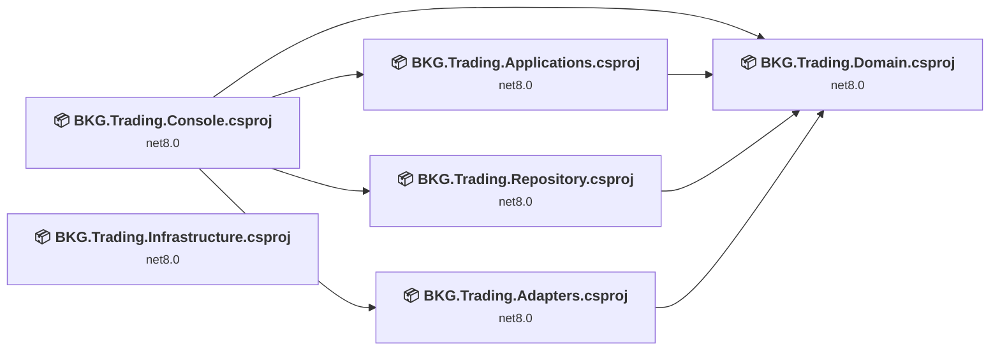
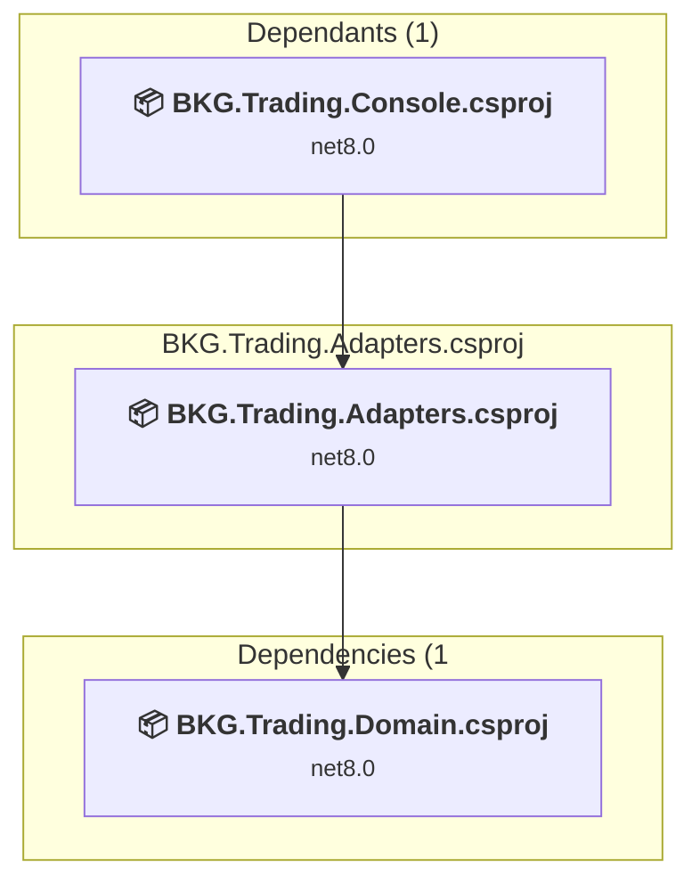
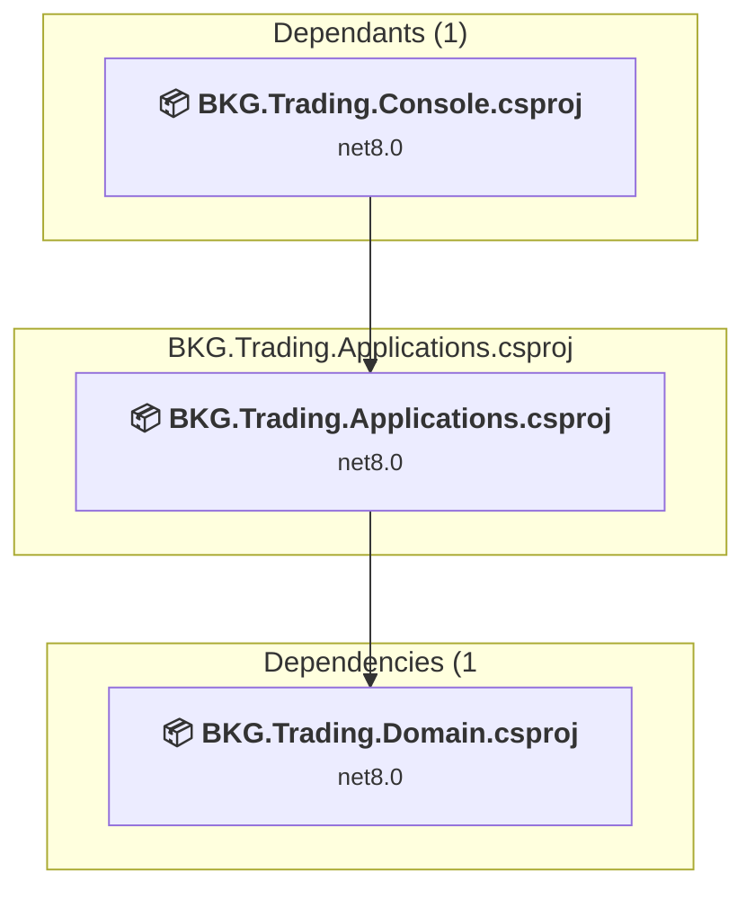
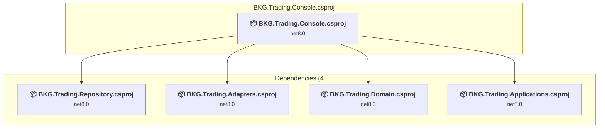
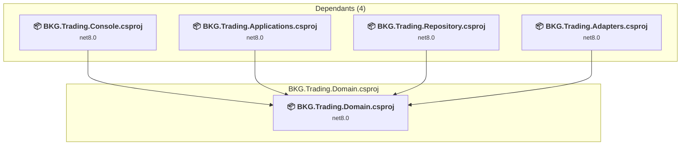
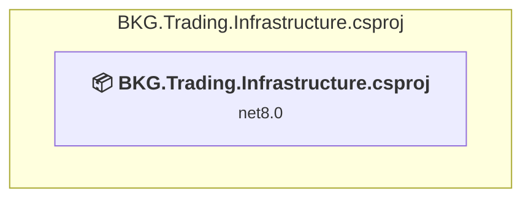
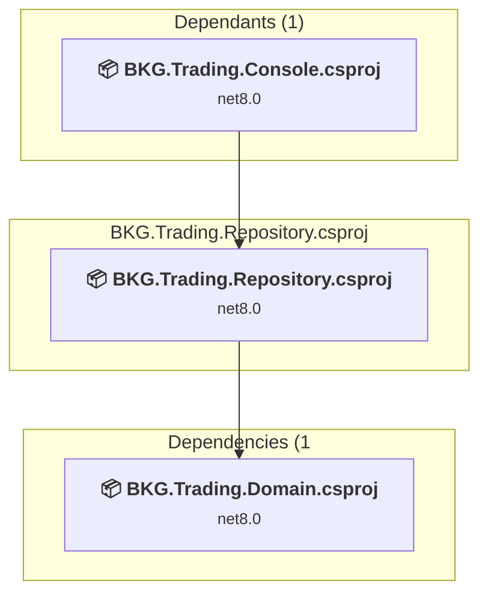

# Projects and dependencies analysis

This document provides a comprehensive overview of the projects and their dependencies in the context of upgrading to .NETCoreApp,Version=v10.0.

## Table of Contents

- [Executive Summary](#executive-Summary)
  - [Highlevel Metrics](#highlevel-metrics)
  - [Projects Compatibility](#projects-compatibility)
  - [Package Compatibility](#package-compatibility)
  - [API Compatibility](#api-compatibility)
  - [Binding Redirect Configuration](#binding-redirect-configuration)
- [Aggregate NuGet packages details](#aggregate-nuget-packages-details)
- [Top API Migration Challenges](#top-api-migration-challenges)
  - [Technologies and Features](#technologies-and-features)
  - [Most Frequent API Issues](#most-frequent-api-issues)
- [Projects Relationship Graph](#projects-relationship-graph)
- [Project Details](#project-details)

  - [BKG.Trading.Adapters\BKG.Trading.Adapters.csproj](#bkgtradingadaptersbkgtradingadapterscsproj)
  - [BKG.Trading.Applications\BKG.Trading.Applications.csproj](#bkgtradingapplicationsbkgtradingapplicationscsproj)
  - [BKG.Trading.Console\BKG.Trading.Console.csproj](#bkgtradingconsolebkgtradingconsolecsproj)
  - [BKG.Trading.Domain\BKG.Trading.Domain.csproj](#bkgtradingdomainbkgtradingdomaincsproj)
  - [BKG.Trading.Infrastructure\BKG.Trading.Infrastructure.csproj](#bkgtradinginfrastructurebkgtradinginfrastructurecsproj)
  - [BKG.Trading.Repository\BKG.Trading.Repository.csproj](#bkgtradingrepositorybkgtradingrepositorycsproj)

## Executive Summary

### Highlevel Metrics

| Metric | Count | Status |
| :--- | :---: | :--- |
| Total Projects | 6 | All require upgrade |
| Total NuGet Packages | 53 | 3 need upgrade |
| Total Code Files | 18 |  |
| Total Code Files with Incidents | 10 |  |
| Total Lines of Code | 1173 |  |
| Total Number of Issues | 16 |  |
| Estimated LOC to modify | 7+ | at least 0.6% of codebase |

### Projects Compatibility

| Project | Target Framework | Difficulty | Package Issues | API Issues | Binding Issues | Est. LOC Impact | Description |
| :--- | :---: | :---: | :---: | :---: | :---: | :---: | :--- |
| [BKG.Trading.Adapters\BKG.Trading.Adapters.csproj](#bkgtradingadaptersbkgtradingadapterscsproj) | net8.0 | 🟢 Low | 0 | 6 | 0 | 6+ | ClassLibrary, Sdk Style = True |
| [BKG.Trading.Applications\BKG.Trading.Applications.csproj](#bkgtradingapplicationsbkgtradingapplicationscsproj) | net8.0 | 🟢 Low | 0 | 0 | 0 |  | ClassLibrary, Sdk Style = True |
| [BKG.Trading.Console\BKG.Trading.Console.csproj](#bkgtradingconsolebkgtradingconsolecsproj) | net8.0 | 🟢 Low | 3 | 1 | 0 | 1+ | DotNetCoreApp, Sdk Style = True |
| [BKG.Trading.Domain\BKG.Trading.Domain.csproj](#bkgtradingdomainbkgtradingdomaincsproj) | net8.0 | 🟢 Low | 0 | 0 | 0 |  | ClassLibrary, Sdk Style = True |
| [BKG.Trading.Infrastructure\BKG.Trading.Infrastructure.csproj](#bkgtradinginfrastructurebkgtradinginfrastructurecsproj) | net8.0 | 🟢 Low | 0 | 0 | 0 |  | ClassLibrary, Sdk Style = True |
| [BKG.Trading.Repository\BKG.Trading.Repository.csproj](#bkgtradingrepositorybkgtradingrepositorycsproj) | net8.0 | 🟢 Low | 0 | 0 | 0 |  | ClassLibrary, Sdk Style = True |

### Package Compatibility

| Status | Count | Percentage |
| :--- | :---: | :---: |
| ✅ Compatible | 50 | 94.3% |
| ⚠️ Incompatible | 0 | 0.0% |
| 🔄 Upgrade Recommended | 3 | 5.7% |
| ***Total NuGet Packages*** | ***53*** | ***100%*** |

### API Compatibility

| Category | Count | Impact |
| :--- | :---: | :--- |
| 🔴 Binary Incompatible | 0 | High - Require code changes |
| 🟡 Source Incompatible | 0 | Medium - Needs re-compilation and potential conflicting API error fixing |
| 🔵 Behavioral change | 7 | Low - Behavioral changes that may require testing at runtime |
| ✅ Compatible | 1447 |  |
| ***Total APIs Analyzed*** | ***1454*** |  |

## Aggregate NuGet packages details

| Package | Current Version | Suggested Version | Projects | Description |
| :--- | :---: | :---: | :--- | :--- |
| CsvTextFieldParser | 1.2.1 |  | [BKG.Trading.Adapters.csproj](#bkgtradingadaptersbkgtradingadapterscsproj) [BKG.Trading.Console.csproj](#bkgtradingconsolebkgtradingconsolecsproj) | ✅Compatible |
| Dapper | 2.1.89 |  | [BKG.Trading.Console.csproj](#bkgtradingconsolebkgtradingconsolecsproj) [BKG.Trading.Repository.csproj](#bkgtradingrepositorybkgtradingrepositorycsproj) | ✅Compatible |
| fyers-api-v3 | 1.6.0 |  | [BKG.Trading.Adapters.csproj](#bkgtradingadaptersbkgtradingadapterscsproj) [BKG.Trading.Console.csproj](#bkgtradingconsolebkgtradingconsolecsproj) | ✅Compatible |
| Microsoft.Bcl.Cryptography | 8.0.0 |  | [BKG.Trading.Console.csproj](#bkgtradingconsolebkgtradingconsolecsproj) [BKG.Trading.Repository.csproj](#bkgtradingrepositorybkgtradingrepositorycsproj) | ✅Compatible |
| Microsoft.CSharp | 4.7.0 |  | [BKG.Trading.Adapters.csproj](#bkgtradingadaptersbkgtradingadapterscsproj) [BKG.Trading.Console.csproj](#bkgtradingconsolebkgtradingconsolecsproj) | ✅Compatible |
| Microsoft.Data.SqlClient | 7.1.1 |  | [BKG.Trading.Console.csproj](#bkgtradingconsolebkgtradingconsolecsproj) [BKG.Trading.Repository.csproj](#bkgtradingrepositorybkgtradingrepositorycsproj) | ✅Compatible |
| Microsoft.Data.SqlClient.Extensions.Abstractions | 7.1.1 |  | [BKG.Trading.Console.csproj](#bkgtradingconsolebkgtradingconsolecsproj) [BKG.Trading.Repository.csproj](#bkgtradingrepositorybkgtradingrepositorycsproj) | ✅Compatible |
| Microsoft.Data.SqlClient.Internal.Logging | 7.1.1 |  | [BKG.Trading.Console.csproj](#bkgtradingconsolebkgtradingconsolecsproj) [BKG.Trading.Repository.csproj](#bkgtradingrepositorybkgtradingrepositorycsproj) | ✅Compatible |
| Microsoft.Data.SqlClient.SNI.runtime | 7.1.0 |  | [BKG.Trading.Console.csproj](#bkgtradingconsolebkgtradingconsolecsproj) [BKG.Trading.Repository.csproj](#bkgtradingrepositorybkgtradingrepositorycsproj) | ✅Compatible |
| Microsoft.Extensions.Caching.Abstractions | 8.0.0 |  | [BKG.Trading.Console.csproj](#bkgtradingconsolebkgtradingconsolecsproj) [BKG.Trading.Repository.csproj](#bkgtradingrepositorybkgtradingrepositorycsproj) | ✅Compatible |
| Microsoft.Extensions.Caching.Memory | 8.0.1 |  | [BKG.Trading.Console.csproj](#bkgtradingconsolebkgtradingconsolecsproj) [BKG.Trading.Repository.csproj](#bkgtradingrepositorybkgtradingrepositorycsproj) | ✅Compatible |
| Microsoft.Extensions.Configuration | 9.0.22 |  | [BKG.Trading.Console.csproj](#bkgtradingconsolebkgtradingconsolecsproj) | ✅Compatible |
| Microsoft.Extensions.Configuration.Abstractions | 9.0.22 |  | [BKG.Trading.Console.csproj](#bkgtradingconsolebkgtradingconsolecsproj) | ✅Compatible |
| Microsoft.Extensions.Configuration.Binder | 9.0.22 | 10.0.15 | [BKG.Trading.Console.csproj](#bkgtradingconsolebkgtradingconsolecsproj) | NuGet package upgrade is recommended |
| Microsoft.Extensions.Configuration.FileExtensions | 9.0.22 |  | [BKG.Trading.Console.csproj](#bkgtradingconsolebkgtradingconsolecsproj) | ✅Compatible |
| Microsoft.Extensions.Configuration.Json | 9.0.22 | 10.0.15 | [BKG.Trading.Console.csproj](#bkgtradingconsolebkgtradingconsolecsproj) | NuGet package upgrade is recommended |
| Microsoft.Extensions.DependencyInjection | 9.0.22 |  | [BKG.Trading.Console.csproj](#bkgtradingconsolebkgtradingconsolecsproj) | ✅Compatible |
| Microsoft.Extensions.DependencyInjection.Abstractions | 8.0.2 |  | [BKG.Trading.Repository.csproj](#bkgtradingrepositorybkgtradingrepositorycsproj) | ✅Compatible |
| Microsoft.Extensions.DependencyInjection.Abstractions | 9.0.22 |  | [BKG.Trading.Console.csproj](#bkgtradingconsolebkgtradingconsolecsproj) | ✅Compatible |
| Microsoft.Extensions.Diagnostics | 9.0.22 |  | [BKG.Trading.Console.csproj](#bkgtradingconsolebkgtradingconsolecsproj) | ✅Compatible |
| Microsoft.Extensions.Diagnostics.Abstractions | 9.0.22 |  | [BKG.Trading.Console.csproj](#bkgtradingconsolebkgtradingconsolecsproj) | ✅Compatible |
| Microsoft.Extensions.FileProviders.Abstractions | 9.0.22 |  | [BKG.Trading.Console.csproj](#bkgtradingconsolebkgtradingconsolecsproj) | ✅Compatible |
| Microsoft.Extensions.FileProviders.Physical | 9.0.22 |  | [BKG.Trading.Console.csproj](#bkgtradingconsolebkgtradingconsolecsproj) | ✅Compatible |
| Microsoft.Extensions.FileSystemGlobbing | 9.0.22 |  | [BKG.Trading.Console.csproj](#bkgtradingconsolebkgtradingconsolecsproj) | ✅Compatible |
| Microsoft.Extensions.Http | 9.0.22 | 10.0.15 | [BKG.Trading.Console.csproj](#bkgtradingconsolebkgtradingconsolecsproj) | NuGet package upgrade is recommended |
| Microsoft.Extensions.Logging | 9.0.22 |  | [BKG.Trading.Console.csproj](#bkgtradingconsolebkgtradingconsolecsproj) | ✅Compatible |
| Microsoft.Extensions.Logging.Abstractions | 8.0.2 |  | [BKG.Trading.Repository.csproj](#bkgtradingrepositorybkgtradingrepositorycsproj) | ✅Compatible |
| Microsoft.Extensions.Logging.Abstractions | 9.0.22 |  | [BKG.Trading.Console.csproj](#bkgtradingconsolebkgtradingconsolecsproj) | ✅Compatible |
| Microsoft.Extensions.Options | 8.0.2 |  | [BKG.Trading.Repository.csproj](#bkgtradingrepositorybkgtradingrepositorycsproj) | ✅Compatible |
| Microsoft.Extensions.Options | 9.0.22 |  | [BKG.Trading.Console.csproj](#bkgtradingconsolebkgtradingconsolecsproj) | ✅Compatible |
| Microsoft.Extensions.Options.ConfigurationExtensions | 9.0.22 |  | [BKG.Trading.Console.csproj](#bkgtradingconsolebkgtradingconsolecsproj) | ✅Compatible |
| Microsoft.Extensions.Primitives | 8.0.0 |  | [BKG.Trading.Repository.csproj](#bkgtradingrepositorybkgtradingrepositorycsproj) | ✅Compatible |
| Microsoft.Extensions.Primitives | 9.0.22 |  | [BKG.Trading.Console.csproj](#bkgtradingconsolebkgtradingconsolecsproj) | ✅Compatible |
| Microsoft.IdentityModel.Abstractions | 8.16.0 |  | [BKG.Trading.Console.csproj](#bkgtradingconsolebkgtradingconsolecsproj) [BKG.Trading.Repository.csproj](#bkgtradingrepositorybkgtradingrepositorycsproj) | ✅Compatible |
| Microsoft.IdentityModel.JsonWebTokens | 8.16.0 |  | [BKG.Trading.Console.csproj](#bkgtradingconsolebkgtradingconsolecsproj) [BKG.Trading.Repository.csproj](#bkgtradingrepositorybkgtradingrepositorycsproj) | ✅Compatible |
| Microsoft.IdentityModel.Logging | 8.16.0 |  | [BKG.Trading.Console.csproj](#bkgtradingconsolebkgtradingconsolecsproj) [BKG.Trading.Repository.csproj](#bkgtradingrepositorybkgtradingrepositorycsproj) | ✅Compatible |
| Microsoft.IdentityModel.Protocols | 8.16.0 |  | [BKG.Trading.Console.csproj](#bkgtradingconsolebkgtradingconsolecsproj) [BKG.Trading.Repository.csproj](#bkgtradingrepositorybkgtradingrepositorycsproj) | ✅Compatible |
| Microsoft.IdentityModel.Protocols.OpenIdConnect | 8.16.0 |  | [BKG.Trading.Console.csproj](#bkgtradingconsolebkgtradingconsolecsproj) [BKG.Trading.Repository.csproj](#bkgtradingrepositorybkgtradingrepositorycsproj) | ✅Compatible |
| Microsoft.IdentityModel.Tokens | 8.16.0 |  | [BKG.Trading.Console.csproj](#bkgtradingconsolebkgtradingconsolecsproj) [BKG.Trading.Repository.csproj](#bkgtradingrepositorybkgtradingrepositorycsproj) | ✅Compatible |
| Microsoft.SqlServer.Server | 1.0.0 |  | [BKG.Trading.Console.csproj](#bkgtradingconsolebkgtradingconsolecsproj) [BKG.Trading.Repository.csproj](#bkgtradingrepositorybkgtradingrepositorycsproj) | ✅Compatible |
| Newtonsoft.Json | 13.0.3 |  | [BKG.Trading.Adapters.csproj](#bkgtradingadaptersbkgtradingadapterscsproj) [BKG.Trading.Console.csproj](#bkgtradingconsolebkgtradingconsolecsproj) | ✅Compatible |
| System.Configuration.ConfigurationManager | 8.0.1 |  | [BKG.Trading.Console.csproj](#bkgtradingconsolebkgtradingconsolecsproj) [BKG.Trading.Repository.csproj](#bkgtradingrepositorybkgtradingrepositorycsproj) | ✅Compatible |
| System.Diagnostics.DiagnosticSource | 9.0.22 |  | [BKG.Trading.Console.csproj](#bkgtradingconsolebkgtradingconsolecsproj) | ✅Compatible |
| System.Diagnostics.EventLog | 8.0.1 |  | [BKG.Trading.Console.csproj](#bkgtradingconsolebkgtradingconsolecsproj) [BKG.Trading.Repository.csproj](#bkgtradingrepositorybkgtradingrepositorycsproj) | ✅Compatible |
| System.IdentityModel.Tokens.Jwt | 8.16.0 |  | [BKG.Trading.Console.csproj](#bkgtradingconsolebkgtradingconsolecsproj) [BKG.Trading.Repository.csproj](#bkgtradingrepositorybkgtradingrepositorycsproj) | ✅Compatible |
| System.IO.Pipelines | 9.0.22 |  | [BKG.Trading.Console.csproj](#bkgtradingconsolebkgtradingconsolecsproj) | ✅Compatible |
| System.Security.Cryptography.Pkcs | 8.0.1 |  | [BKG.Trading.Console.csproj](#bkgtradingconsolebkgtradingconsolecsproj) [BKG.Trading.Repository.csproj](#bkgtradingrepositorybkgtradingrepositorycsproj) | ✅Compatible |
| System.Security.Cryptography.ProtectedData | 8.0.0 |  | [BKG.Trading.Console.csproj](#bkgtradingconsolebkgtradingconsolecsproj) [BKG.Trading.Repository.csproj](#bkgtradingrepositorybkgtradingrepositorycsproj) | ✅Compatible |
| System.Text.Encodings.Web | 9.0.22 |  | [BKG.Trading.Console.csproj](#bkgtradingconsolebkgtradingconsolecsproj) | ✅Compatible |
| System.Text.Json | 4.7.1 |  | [BKG.Trading.Adapters.csproj](#bkgtradingadaptersbkgtradingadapterscsproj) | ✅Compatible |
| System.Text.Json | 9.0.22 |  | [BKG.Trading.Console.csproj](#bkgtradingconsolebkgtradingconsolecsproj) | ✅Compatible |
| System.Threading.RateLimiting | 8.0.0 |  | [BKG.Trading.Console.csproj](#bkgtradingconsolebkgtradingconsolecsproj) [BKG.Trading.Repository.csproj](#bkgtradingrepositorybkgtradingrepositorycsproj) | ✅Compatible |
| Tech.Zerodha.KiteConnect | 4.3.0 |  | [BKG.Trading.Adapters.csproj](#bkgtradingadaptersbkgtradingadapterscsproj) [BKG.Trading.Console.csproj](#bkgtradingconsolebkgtradingconsolecsproj) | ✅Compatible |

## Top API Migration Challenges

### Technologies and Features

| Technology | Issues | Percentage | Migration Path |
| :--- | :---: | :---: | :--- |

### Most Frequent API Issues

| API | Count | Percentage | Category |
| :--- | :---: | :---: | :--- |
| T:System.Text.Json.JsonDocument | 4 | 57.1% | Behavioral Change |
| T:System.Net.Http.HttpContent | 2 | 28.6% | Behavioral Change |
| M:Microsoft.Extensions.DependencyInjection.HttpClientFactoryServiceCollectionExtensions.AddHttpClient(Microsoft.Extensions.DependencyInjection.IServiceCollection) | 1 | 14.3% | Behavioral Change |

## Projects Relationship Graph

Legend:
📦 SDK-style project
⚙️ Classic project

## Project Details

### BKG.Trading.Adapters\BKG.Trading.Adapters.csproj

#### Project Info

- **Current Target Framework:** net8.0
- **Proposed Target Framework:** net10.0
- **SDK-style**: True
- **Project Kind:** ClassLibrary
- **Dependencies**: 1
- **Dependants**: 1
- **Number of Files**: 4
- **Number of Files with Incidents**: 4
- **Lines of Code**: 608
- **Estimated LOC to modify**: 6+ (at least 1.0% of the project)

#### Dependency Graph

Legend:
📦 SDK-style project
⚙️ Classic project

### API Compatibility

| Category | Count | Impact |
| :--- | :---: | :--- |
| 🔴 Binary Incompatible | 0 | High - Require code changes |
| 🟡 Source Incompatible | 0 | Medium - Needs re-compilation and potential conflicting API error fixing |
| 🔵 Behavioral change | 6 | Low - Behavioral changes that may require testing at runtime |
| ✅ Compatible | 744 |  |
| ***Total APIs Analyzed*** | ***750*** |  |

### BKG.Trading.Applications\BKG.Trading.Applications.csproj

#### Project Info

- **Current Target Framework:** net8.0
- **Proposed Target Framework:** net10.0
- **SDK-style**: True
- **Project Kind:** ClassLibrary
- **Dependencies**: 1
- **Dependants**: 1
- **Number of Files**: 7
- **Number of Files with Incidents**: 1
- **Lines of Code**: 329
- **Estimated LOC to modify**: 0+ (at least 0.0% of the project)

#### Dependency Graph

Legend:
📦 SDK-style project
⚙️ Classic project

### API Compatibility

| Category | Count | Impact |
| :--- | :---: | :--- |
| 🔴 Binary Incompatible | 0 | High - Require code changes |
| 🟡 Source Incompatible | 0 | Medium - Needs re-compilation and potential conflicting API error fixing |
| 🔵 Behavioral change | 0 | Low - Behavioral changes that may require testing at runtime |
| ✅ Compatible | 461 |  |
| ***Total APIs Analyzed*** | ***461*** |  |

### BKG.Trading.Console\BKG.Trading.Console.csproj

#### Project Info

- **Current Target Framework:** net8.0
- **Proposed Target Framework:** net10.0
- **SDK-style**: True
- **Project Kind:** DotNetCoreApp
- **Dependencies**: 4
- **Dependants**: 0
- **Number of Files**: 1
- **Number of Files with Incidents**: 2
- **Lines of Code**: 143
- **Estimated LOC to modify**: 1+ (at least 0.7% of the project)

#### Dependency Graph

Legend:
📦 SDK-style project
⚙️ Classic project

### API Compatibility

| Category | Count | Impact |
| :--- | :---: | :--- |
| 🔴 Binary Incompatible | 0 | High - Require code changes |
| 🟡 Source Incompatible | 0 | Medium - Needs re-compilation and potential conflicting API error fixing |
| 🔵 Behavioral change | 1 | Low - Behavioral changes that may require testing at runtime |
| ✅ Compatible | 193 |  |
| ***Total APIs Analyzed*** | ***194*** |  |

### BKG.Trading.Domain\BKG.Trading.Domain.csproj

#### Project Info

- **Current Target Framework:** net8.0
- **Proposed Target Framework:** net10.0
- **SDK-style**: True
- **Project Kind:** ClassLibrary
- **Dependencies**: 0
- **Dependants**: 4
- **Number of Files**: 5
- **Number of Files with Incidents**: 1
- **Lines of Code**: 51
- **Estimated LOC to modify**: 0+ (at least 0.0% of the project)

#### Dependency Graph

Legend:
📦 SDK-style project
⚙️ Classic project

### API Compatibility

| Category | Count | Impact |
| :--- | :---: | :--- |
| 🔴 Binary Incompatible | 0 | High - Require code changes |
| 🟡 Source Incompatible | 0 | Medium - Needs re-compilation and potential conflicting API error fixing |
| 🔵 Behavioral change | 0 | Low - Behavioral changes that may require testing at runtime |
| ✅ Compatible | 26 |  |
| ***Total APIs Analyzed*** | ***26*** |  |

### BKG.Trading.Infrastructure\BKG.Trading.Infrastructure.csproj

#### Project Info

- **Current Target Framework:** net8.0
- **Proposed Target Framework:** net10.0
- **SDK-style**: True
- **Project Kind:** ClassLibrary
- **Dependencies**: 0
- **Dependants**: 0
- **Number of Files**: 0
- **Number of Files with Incidents**: 1
- **Lines of Code**: 0
- **Estimated LOC to modify**: 0+ (at least 0.0% of the project)

#### Dependency Graph

Legend:
📦 SDK-style project
⚙️ Classic project

### API Compatibility

| Category | Count | Impact |
| :--- | :---: | :--- |
| 🔴 Binary Incompatible | 0 | High - Require code changes |
| 🟡 Source Incompatible | 0 | Medium - Needs re-compilation and potential conflicting API error fixing |
| 🔵 Behavioral change | 0 | Low - Behavioral changes that may require testing at runtime |
| ✅ Compatible | 0 |  |
| ***Total APIs Analyzed*** | ***0*** |  |

### BKG.Trading.Repository\BKG.Trading.Repository.csproj

#### Project Info

- **Current Target Framework:** net8.0
- **Proposed Target Framework:** net10.0
- **SDK-style**: True
- **Project Kind:** ClassLibrary
- **Dependencies**: 1
- **Dependants**: 1
- **Number of Files**: 1
- **Number of Files with Incidents**: 1
- **Lines of Code**: 42
- **Estimated LOC to modify**: 0+ (at least 0.0% of the project)

#### Dependency Graph

Legend:
📦 SDK-style project
⚙️ Classic project

### API Compatibility

| Category | Count | Impact |
| :--- | :---: | :--- |
| 🔴 Binary Incompatible | 0 | High - Require code changes |
| 🟡 Source Incompatible | 0 | Medium - Needs re-compilation and potential conflicting API error fixing |
| 🔵 Behavioral change | 0 | Low - Behavioral changes that may require testing at runtime |
| ✅ Compatible | 23 |  |
| ***Total APIs Analyzed*** | ***23*** |  |

